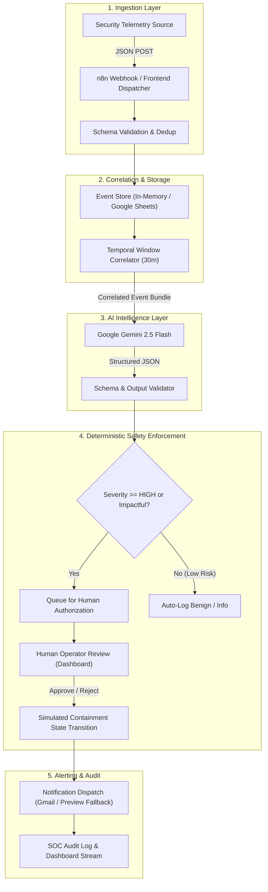

# Rogue Protocol — Autonomous AI Security Incident Response Agent

> **Hackathon Problem Statement:** PS22 — AI Automation using n8n  
> **Classification:** Safe Simulated Cybersecurity Operations Center (SOC) Demonstration

---

## 1. Project Overview

Modern Security Operations Centers (SOCs) are overwhelmed by thousands of fragmented alerts every day. Analysts spend critical hours manually piecing together individual logs, verifying whether events are connected, assessing threat severity, and deciding on containment actions.

**Rogue Protocol** is an autonomous AI-powered security incident response system that:
1. **Ingests** security events in real-time via an automated n8n webhook.
2. **Correlates** fragmented events occurring within temporal windows for the same identity.
3. **Analyzes** multi-stage threat patterns with Google Gemini AI to assign calibrated severity (`LOW`, `MEDIUM`, `HIGH`, `CRITICAL`), confidence metrics, observed facts, and reasoning.
4. **Recommends** prioritized mitigation actions.
5. **Enforces Deterministic Safety Gates**: High-impact containment actions (such as account restrictions and edge IP blocks) strictly require explicit **Human-in-the-Loop approval** before execution.
6. **Maintains a Verifiable Audit Trail**: Every ingestion, AI analysis, notification dispatch, and human decision is immutably logged.

---

## 2. Architecture & Workflow



---

## 3. Technology Stack

* **Frontend Dashboard:**
  * React 19 + TypeScript + Vite
  * Tailwind CSS v4 (SOC Dark Palette: `#080c14`, cyan, amber, rose accents)
  * Lucide Icons
  * Recharts
* **Automation & Orchestration:**
  * n8n Community Edition (15-node workflow)
  * Webhook Ingestion (`/webhook/security-event`)
  * Docker Compose support
* **AI Analysis:**
  * Google Gemini API (`gemini-2.5-flash` with structured JSON schema)
  * Deterministic fallback correlation engine for zero-dependency demos
* **Persistence & Audit:**
  * LocalStorage browser persistence + In-Memory event bus
  * Google Sheets schema ready

---

## 4. Quick Start Guide

### Step 1: Run the SOC Dashboard (Frontend)
The application is pre-configured to run on port `3000`:

```powershell
npm run dev
```
Open **[http://localhost:3000](http://localhost:3000)** in your browser.

### Step 2: (Optional) Run n8n with Docker
If you wish to run the full n8n automation canvas locally:

```powershell
docker compose up -d
```
1. Open n8n at **`http://localhost:5678`**.
2. Click **Add workflow** &rarr; **Import from File...** &rarr; select `n8n/rogue-protocol-workflow.json`.
3. Activate the workflow!

> **Note on Resiliency:** If n8n or Docker is not running, the dashboard's intelligent fallback engine automatically processes all 3 attack scenarios client-side with full schema compliance. No external dependencies are required to judge the demo.

---

## 5. Demo Scenarios for Judges

The dashboard provides dedicated 1-click scenario triggers:

### Scenario 1: Normal Activity (Benign)
* **What happens:** Single routine login from a familiar domestic IP (`alex.mercer@fictional-corp.internal`, Boston, USA).
* **Expected Result:** Evaluated as benign. Severity: `LOW` (or no incident created). Counters update without false alarms.

### Scenario 2: Suspicious Login Pattern (Investigate)
* **What happens:** 2 failed login attempts followed immediately by a successful login from an unexpected foreign IP in Singapore for `david.chen@fictional-corp.internal`.
* **Expected Result:** AI correlates temporal proximity and flags `MEDIUM` severity. Status: `INVESTIGATING`. Recommends step-up MFA challenge.

### Scenario 3: Possible Account Takeover & Exfiltration (Critical)
* **What happens:** 5 multi-stage events within 30 minutes for `rachel.adams@fictional-corp.internal`:
  1. Credential spray attempt from Moscow, Russia.
  2. Anomalous login via TOR exit node.
  3. Master password changed.
  4. 6.2 GB customer contracts archive downloaded via rclone.
  5. Legitimate employee files emergency lockout report.
* **Expected Result:**
  * Correlated into a single `CRITICAL` / `HIGH` severity incident.
  * AI produces clear reasoning and observed evidence facts.
  * High-risk containment action (**Simulate Emergency Account Freeze**) triggers the **Human-in-the-Loop Approval Queue**.
  * Alert notification preview generated.
  * Judge can approve or reject the action, verifying that status transitions to `CONTAINED` with full audit logs.

---

## 6. Safety & Simulated Scope

* **100% Safe Simulation:** Uses purely fictional user identities (`@fictional-corp.internal`), non-routable IPs, and simulated API tokens.
* **No Destructive Operations:** Buttons and approvals update the incident lifecycle within the application state only. They do not alter real user accounts, block real IP addresses, or scan real networks.
* **Honest Integrations:** If Gmail is not configured, the dashboard explicitly identifies notifications as **"Preview Fallback"** and never fakes successful SMTP delivery.

---

## 7. 3-Minute Demo Presentation Script

1. **Introduction (30s):**  
   *"Welcome to Rogue Protocol, our autonomous AI incident response agent solving problem statement PS22. Security teams drown in disconnected alerts; our system connects fragmented signals into cohesive, actionable incidents."*
2. **Overview Dashboard (30s):**  
   *Show the Overview page at `http://localhost:3000` with KPIs, live status strip, severity distribution, and recent activity.*
3. **Trigger Scenario 1 & 2 (45s):**  
   *Navigate to Demo Controls. Trigger 'Normal Activity' (shows zero false alerts). Then trigger 'Suspicious Login' to show instant event correlation.*
4. **Trigger Scenario 3 — Multi-Stage Attack (60s):**  
   *Trigger 'Possible Account Compromise'. Open the Incident Details page. Walk through the AI Executive Summary, Observed Evidence Facts, AI Reasoning, and the Correlated Event Timeline.*
5. **Human Approval & Audit Trail (30s):**  
   *Navigate to Approvals. Show the pending containment card. Click 'Approve Containment' through the confirmation dialog. Show the incident status updated to 'CONTAINED' and point out the corresponding audit log entry.*
